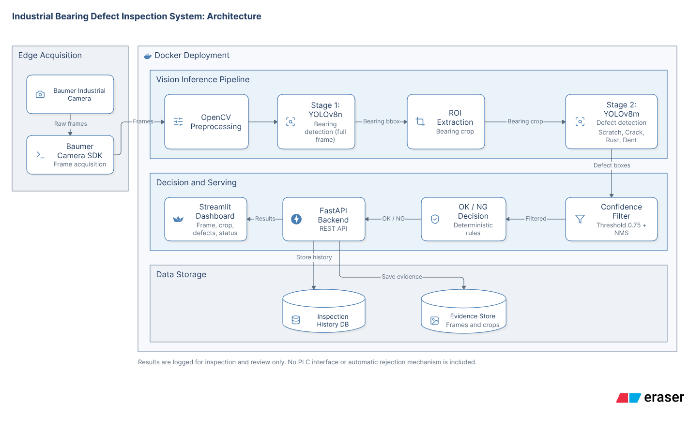
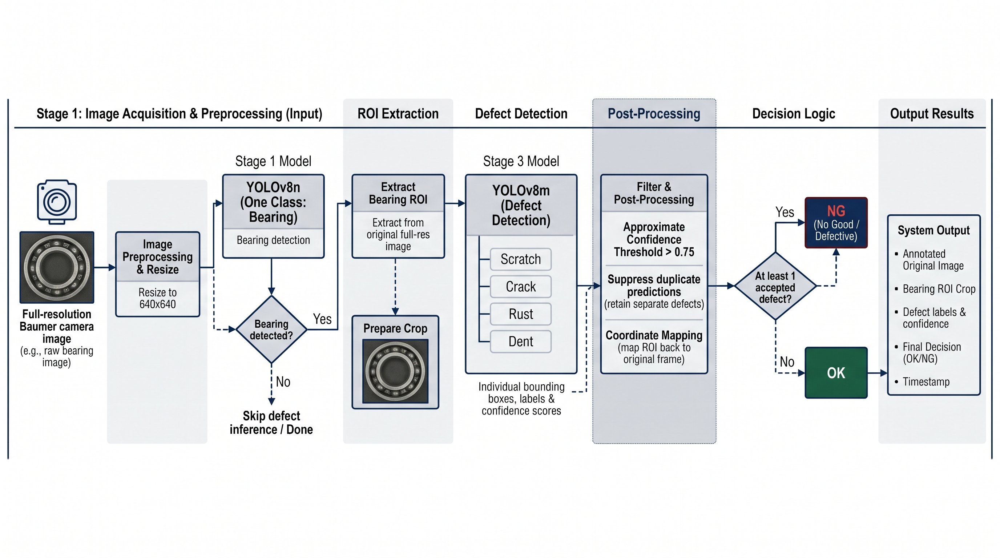
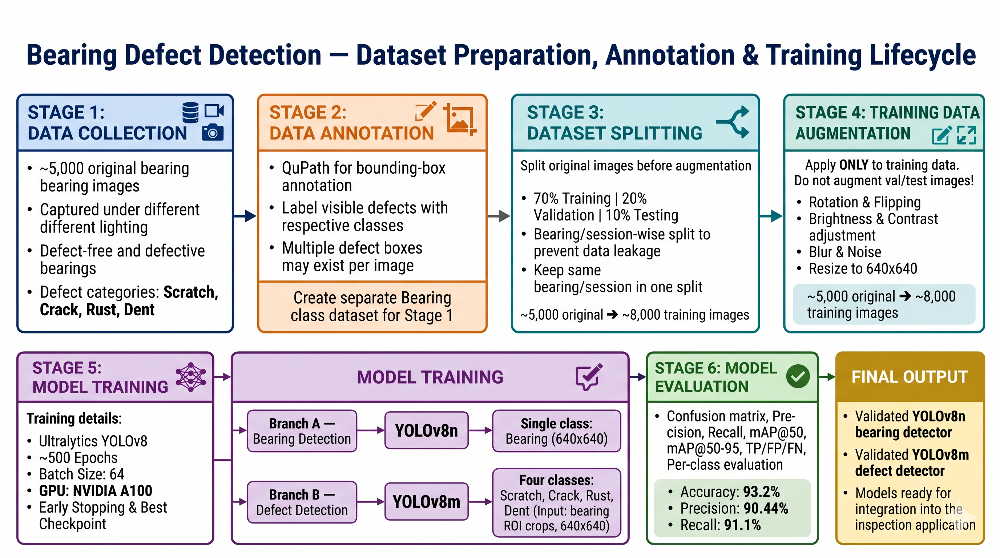
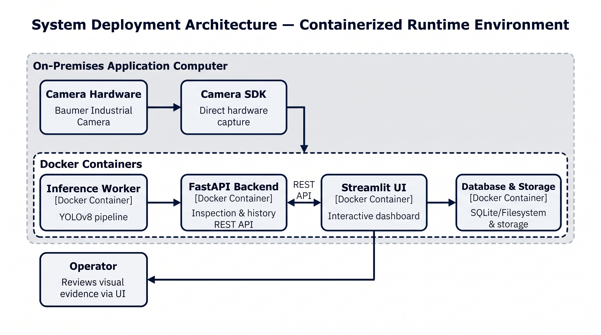

# Industrial Bearing Defect Inspection System

> Documentation-only portfolio repository showcasing a two-stage YOLOv8-based computer vision system for industrial bearing surface defect inspection. Proprietary source code, trained model weights, client datasets, and confidential implementation details are excluded.

## Project Overview

The Industrial Bearing Defect Inspection System is a computer vision-based quality inspection solution designed to identify visible surface defects in manufactured bearings and generate an **OK / NG (Not Good)** inspection result.

The system uses a two-stage object detection architecture:

1. **Bearing Localization – YOLOv8n:** Detects the bearing in the input camera frame and extracts its Region of Interest (ROI).
2. **Defect Detection – YOLOv8m:** Inspects the extracted bearing region to identify surface defects.
3. **Decision Logic:** Applies confidence filtering and duplicate suppression. If one or more qualifying defects are detected, the bearing is classified as NG; otherwise, it is classified as OK.

### Defect Categories

- Scratch
- Crack
- Rust
- Dent

## System Architecture

The system follows a modular architecture integrating industrial image acquisition, computer vision inference, backend services, dashboard visualization, and inspection history management.



## Computer Vision Pipeline

The inspection process follows a two-stage detection approach.



**Stage 1 – Bearing Detection**
- Input: Full camera frame.
- Model: YOLOv8n.
- Class: Bearing.
- Output: Bearing bounding box and confidence score.
- Purpose: Localize the bearing and extract its ROI.

**Stage 2 – Defect Detection**
- Input: Cropped bearing ROI.
- Model: YOLOv8m.
- Classes: Scratch, Crack, Rust, Dent.
- Output: Defect bounding boxes, class labels, and confidence scores.

**Final Inspection Decision**

| Condition | Result |
|---|---|
| One or more accepted defect detections | NG |
| No accepted defect detections | OK |

The final OK/NG classification is rule-based post-processing, not a separate neural network classifier.

## Dataset Preparation and Model Development



### Dataset Details

| Parameter | Details |
|---|---|
| Original images | Approximately 5,000 |
| Training split | 70% |
| Validation split | 20% |
| Testing split | 10% |
| Augmented training images | Approximately 8,000 |
| Annotation tool | QuPath |
| Image preparation | 640 × 640 |
| Split strategy | Bearing/session-wise grouping |

### Data Augmentation

The training dataset was expanded using:
- Rotation
- Horizontal and vertical flipping
- Brightness and contrast adjustments
- Blur
- Noise

Augmentation was applied to the training partition only. Validation and test data were kept free from random training augmentation.

### Model Training Configuration

| Parameter | Stage 1 | Stage 2 |
|---|---|---|
| Architecture | YOLOv8n | YOLOv8m |
| Task | Bearing localization | Defect detection |
| Classes | Bearing | Scratch, Crack, Rust, Dent |
| Input size | 640 × 640 | 640 × 640 |
| Epochs | Approximately 500 | Approximately 500 |
| Batch size | 64 | 64 |

**Training environment:** NVIDIA A100 GPU on an IIT server (recalled configuration; pending training-log verification).

## Reported Model Performance

The following metrics were recalled from the project:

| Evaluation Metric | Reported Value |
|---|---:|
| Accuracy | 93.2% |
| Precision | 90.44% |
| Recall | 91.1% |

**Note:** These are reported project figures, not independently audited benchmarks. The original evaluation report, metric averaging methodology, class-wise breakdown, and test-set definition have not yet been recovered. mAP and FPS values are therefore not reported.

## Technology Stack

| Category | Technologies |
|---|---|
| Programming Language | Python |
| Computer Vision | OpenCV |
| Object Detection | Ultralytics YOLOv8 |
| Deep Learning | PyTorch |
| Camera Acquisition | Baumer Industrial Camera, Camera SDK |
| Annotation | QuPath |
| Backend | FastAPI |
| Dashboard | Streamlit |
| Deployment | Docker |
| Data Persistence | Database (exact engine not recovered) |

## Runtime and Deployment Architecture



### Image Acquisition
- Original setup used a Baumer industrial camera.
- Camera SDK was used for image acquisition.
- The camera was positioned above the bearing in a separate test setup.

### Backend and Inference
- Python and OpenCV handled image processing.
- YOLOv8 models performed bearing localization and defect detection.
- FastAPI provided backend integration.

### Dashboard and Inspection Results
The Streamlit dashboard presented:
- Input camera frame.
- Detected bearing ROI.
- Defect bounding boxes and labels.
- Confidence scores.
- Final OK/NG status.
- Inspection timestamps and history.

### Deployment
Docker was used for application packaging and deployment.

The original workflow was dashboard-based. Automatic PLC-based rejection or conveyor control was not part of the confirmed project scope.

## Key Technical Highlights

- Two-stage YOLOv8 architecture for localized industrial defect inspection.
- ROI-based inference to focus defect detection on the bearing surface.
- Multi-class defect detection covering four surface defect categories.
- Confidence-based prediction filtering.
- Duplicate detection suppression.
- Rule-based OK/NG decision mechanism.
- Bearing/session-wise dataset splitting to reduce data leakage.
- FastAPI backend and Streamlit dashboard integration.
- Docker-based application packaging.

## Challenges and Limitations

Some of the key inspection challenges included:

- Detecting small and subtle surface scratches and dents.
- Handling reflections and varying surface appearances.
- Managing class imbalance across defect categories.
- Reducing false positives caused by surface texture and reflections.
- Maintaining reliable defect detection under lighting variations.

Potential improvements include controlled illumination, additional difficult-condition samples, per-class recall analysis, confidence calibration, and end-to-end latency measurement.

## Repository Structure

```text
industrial-bearing-defect-inspection/
│
├── README.md
│
└── src/
    ├── 01_system_architecture.png
    ├── 02_two_stage_cv_pipeline.png
    ├── 03_dataset_training_lifecycle.png
    └── 04_runtime_deployment_flow.png
```

This is a documentation-only repository. It does not contain executable source code, model weights, or client datasets.

## Confidentiality and Disclaimer

This repository is intended for professional portfolio and technical documentation purposes.

The following materials are intentionally excluded:
- Proprietary source code.
- Trained model weights.
- Client images and videos.
- Internal datasets and annotations.
- Camera credentials and network configurations.
- Private API keys and database credentials.
- Internal production URLs and deployment secrets.

Project details are documented at an architectural and capability level. Public disclosure is subject to the former employer's confidentiality and authorization requirements.

## Author

**Computer Vision / AI-ML Engineer**

Focus Areas: Computer Vision, Object Detection, Industrial Inspection, Deep Learning, Image Processing, and AI Application Deployment.


